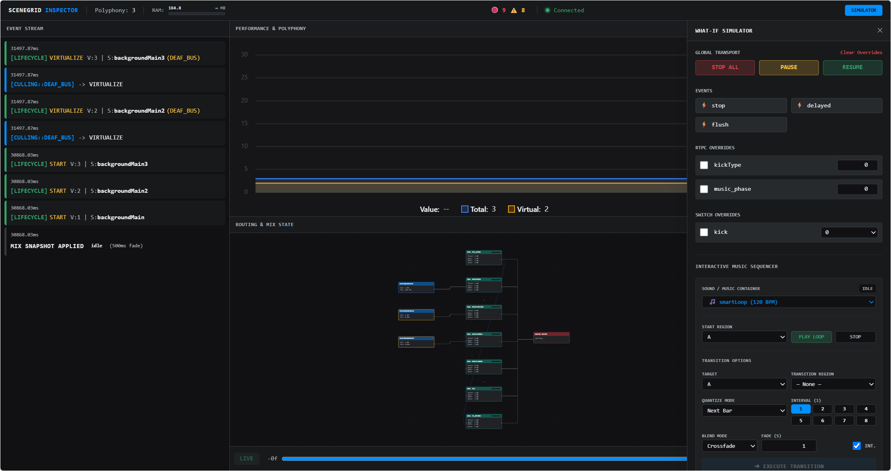

<div align="center">

# SceneGrid Console

**Data-driven audio middleware & runtime observability platform for the web.**
*Zero-GC audio engine, deterministic voice culling, and live visual inspection for web games.*

[](https://github.com/rapt0p7/scenegrid-console/actions/workflows/ci.yml)
[](https://github.com/rapt0p7/scenegrid-console/actions/workflows/publish.yml)
[](https://www.npmjs.com/package/@scene-grid/engine)
[](https://www.typescriptlang.org/)
<br>
[](https://dashboard.stryker-mutator.io/reports/github.com/rapt0p7/scenegrid-console/main)
[](https://codecov.io/gh/rapt0p7/scenegrid-console)
[](https://app.codacy.com/gh/rapt0p7/scenegrid-console/dashboard?utm_source=gh&utm_medium=referral&utm_content=&utm_campaign=Badge_grade)
[](https://repowise.dev/repo/rapt0p7/scenegrid-console)


<br>
[](https://rapt0p7.github.io/scenegrid-console/dashboard/live/)
[](https://deepwiki.com/rapt0p7/scenegrid-console)
[](https://rapt0p7.github.io/scenegrid-console/openwiki-visualizer/)
[](https://hub.xerj.org/contributors/rapt0p7)
[](./LICENSE)

<br>



</div>

---

## 💡 Why SceneGrid?

Modern 60-FPS web games and WebGL experiences fail when browser Garbage Collection (GC) pauses audio or causes frame stuttering. Standard web audio libraries treat sound as isolated triggers; **SceneGrid brings AAA-grade audio middleware (FMOD/Wwise architecture) to the browser.**

| Feature | Standard Web Audio / Howler | SceneGrid |
| :--- | :--- | :--- |
| **Memory Allocation** | Frequent GC spikes during heavy playback | **Zero-allocation object pools** (`O(1)` free-list & swap-and-pop) |
| **Voice Management** | Uncontrolled polyphony / overlapping | **Deterministic voice culling & virtualization** (with hysteresis) |
| **Mixing States** | Manual volume math in game logic | **Total Recall VCA Snapshots** & multi-layer crossfades |
| **Observability** | Console logs / blind debugging | **Real-time DevTools inspector, cause chains & signal graph** |
| **Dynamic Audio (RTPC)** | Raw frame-by-frame setters | **FPS-independent modulation curves & slew-rate inertia** |
| **Interactive Music** | Manual track switching / drift | **Autonomous FSM Music Conductor** & beat-quantized smart loops |
| **Config & Routing** | Imperative code / silent runtime failures | **AOT Static Graph Validation** (cycle detection & RAM quotas) |

> ℹ️ *Building a simple promo site or lightweight puzzle? You probably don't need SceneGrid — check out [zvuk](https://github.com/schmooky/zvuk) or [soundhub](https://github.com/chriscreativecode/soundhub). If you're building a high-load game engine with complex routing — SceneGrid is for you.*

---

## ⚡ Quick Start

### 1. Install

```bash
npm install @scene-grid/engine
npm install @scene-grid/debugger --save-dev
```

### 2. Minimal Example

```typescript
import { AudioEngine, WorkletLoader } from '@scene-grid/engine';
import * as config from './audio-config/index.js';

// 1. Initialize engine with your data-driven manifests & voice limits
const audio = new AudioEngine({
  ...config,
  globalVoiceLimit: 32 // Hard limit to eliminate GC spikes
});

await audio.init({ isStrictValidation: true });

// 2. Play sound on user interaction (unlocked browser context)
window.addEventListener('pointerup', async () => {
  await audio.unlock();
  audio.play('backgroundMain', { isLoop: true });

  // 3. Attach live visual inspector in development
  if (process.env.NODE_ENV !== 'production') {
    const { attachDebugUI, initAudioDebugPanel } = await import('@scene-grid/debugger');
    await attachDebugUI(audio, { wrapperSelector: '#wrapper', workletLoader: WorkletLoader });
    initAudioDebugPanel(audio);
  }
}, { once: true });
```

👉 *For full TypeScript manifest generation, sound maps, banks, and HMR setup, see [examples/main.ts](./examples/main.ts).*

---

## ✨ Key Features

* **Zero-Allocation Pools (DOD):** Eliminates frame stutter by pooling voices and telemetry into static flat arrays with `O(1)` swap-and-pop cleanup.
* **Deterministic Voice Culling:** Transparently virtualizes low-priority sounds with anti-flutter hysteresis when the audio budget is exceeded.
* **AOT Static Graph Validation:** Catches routing cycles, ghost ducking conflicts, and RAM quota violations at startup before allocating Web Audio nodes.
* **Total Recall VCA Snapshots:** Superimposes multi-layer mix states (e.g., *Exploration* → *Combat*) with sample-accurate crossfades.
* **Lookahead Sidechain Ducking:** Predictive attenuation via `AudioWorklet` to dip background buses *before* transient peaks hit.
* **Interactive Music & Smart Loops:** Autonomous FSM conductor, overlap-preserving loops (`preEntry` / `tail`), phase-aware jumps, and beat-quantized stingers.
* **Event Macros & Logical Containers:** Semantic `postEvent()` triggers, `Switch` / `Scatterer` containers, and deterministic variations via `SeededPRNG`.
* **Memory Hygiene & LRU Quotas:** Logical asset banks, concurrency-throttled decoding, and automatic LRU buffer eviction to prevent OOM crashes.
* **Decoupled Hexagonal Architecture:** Domain logic is strictly separated from Web Audio nodes, with live HMR config reloading and full IDE autocomplete.

---

## 📦 Packages in this Monorepo

| Package | Purpose |
| :--- | :--- |
| [](./packages/engine) | Core zero-allocation runtime and domain audio logic |
| [](./packages/debugger) | In-game visual overlay, live bus meters, and voice culling tracer |
| [](./packages/inspector) | Standalone UI inspector components |
| [](./packages/cli) | Ahead-of-Time asset processing & manifest generator |
| [](./packages/mcp-server) | Model Context Protocol server for AI/tooling telemetry |
| [](./packages/shared) | Shared kernels, type definitions, and math helpers |

---

## 📖 Deep Dives & Documentation

Detailed architectural decisions and design docs are available separately:

* 🏛️ **[Architecture Guide (C4 & Topology)](./docs/ARCHITECTURE.md)** — English | [Русская версия](./docs/ARCHITECTURE[RU].md)
* 🎛️ **[Audio Signal Flow Diagram](./docs/audio-flow.svg)**
* 🗺️ **[Development Roadmap & Milestones](./ROADMAP.md)**

---

## Support & Sponsorship

If SceneGrid helps your project, consider supporting its development:

- 💰 **[GitHub Sponsors](https://github.com/sponsors/rapt0p7)** — Recurring support
- ☕ **[Buy Me a Coffee](https://buymeacoffee.com/rapt0p7)** — One-time tip
- 🎁 **[Patreon](https://patreon.com/rapt0p7)** — Join the community

---

## 📄 License

MIT © [Igor Zabrodin](https://github.com/rapt0p7). Free for commercial games, apps, and interactive sites.
